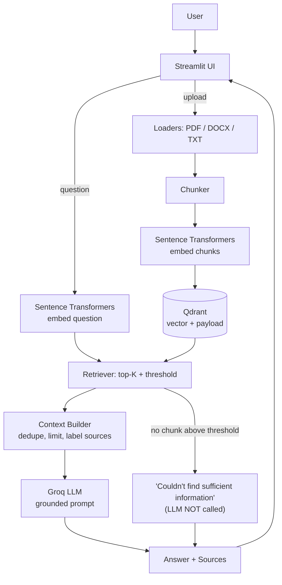

# QA Knowledge Bot – RAG Pipeline

Ask questions about your own PDF / DOCX / TXT files. Answers are generated by an LLM (Groq) **only from retrieved passages** of your documents, and every answer shows the sources it came from.

**Stack:** Python 3.11+ · Sentence Transformers (`all-MiniLM-L6-v2`) · Qdrant · Groq · Streamlit · Pydantic · pytest

---

## 1. What is RAG?
**Retrieval-Augmented Generation** = *look up* relevant text first, then let an LLM *write* an answer using that text.

## 2. Why RAG instead of asking the LLM directly?
| Asking Groq directly | RAG |
|---|---|
| Model has never seen your private documents | Your documents are searched at question time |
| Invents plausible-sounding answers | Told to answer only from supplied text, else say "not available" |
| No way to verify | Shows the exact source chunks |
| Updating knowledge = retraining | Updating knowledge = upload a file |
| Whole documents don't fit in the prompt | Only the top few relevant chunks are sent |

## 3. Architecture



## 4. Project structure
```
qa-knowledge-bot/
├── app/
│   ├── main.py                     # Streamlit entry point
│   ├── config.py                   # Settings from env vars
│   ├── errors.py                   # Exceptions with user-safe messages
│   ├── models/schemas.py           # Pydantic models (metadata defined once)
│   ├── ingestion/                  # pdf/docx/txt loaders, loader dispatcher, chunker
│   ├── embeddings/embedding_service.py
│   ├── vector_store/qdrant_store.py
│   ├── retrieval/                  # retriever.py, context_builder.py
│   ├── llm/groq_client.py          # system prompt + Groq call + error mapping
│   ├── services/qa_service.py      # orchestrates ingestion and question answering
│   └── ui/                         # sidebar.py, chat.py
├── data/uploads/                   # saved uploads (git-ignored)
├── data/sample_docs/               # sample TXT + PDF for the demo
├── qdrant_storage/                 # local vector DB files (git-ignored)
├── tests/
├── .env.example  .gitignore  requirements.txt  pytest.ini
└── Dockerfile  docker-compose.yml  (optional)
```
*Note:* the UI is Streamlit, calling the service layer directly. I did **not** add FastAPI: a separate API would add a second process and JSON plumbing without helping this single-user demo. `QAService` is UI-independent, so wrapping it in FastAPI later is a small change.

## 5. Installation (fresh machine)

Requires Python 3.11+ and internet on first run (downloads the ~90 MB embedding model).

```bash
git clone <your-repo-url> qa-knowledge-bot
cd qa-knowledge-bot

python -m venv .venv
source .venv/bin/activate          # Windows PowerShell: .venv\Scripts\Activate.ps1
pip install --upgrade pip
pip install -r requirements.txt

cp .env.example .env               # Windows: copy .env.example .env
# edit .env and set GROQ_API_KEY
```

### Groq API key
Create a free key at <https://console.groq.com/keys> and put it in `.env` as `GROQ_API_KEY=...`. The default model is `llama-3.3-70b-versatile` (listed as a production model in Groq's docs when this project was written). Models get deprecated: if you see *"model not found"*, pick a current one from <https://console.groq.com/docs/models> and set `GROQ_MODEL` in `.env`.

### Qdrant
* **Default (no setup):** embedded local mode; data is stored in `./qdrant_storage`. Limitation: only **one process** can open that folder at a time.
* **Docker server (optional):**
  ```bash
  docker run -p 6333:6333 -v qdrant_data:/qdrant/storage qdrant/qdrant
  ```
  then set `QDRANT_URL=http://localhost:6333` in `.env`.

## 6. Run
```bash
streamlit run app/main.py
```
Open <http://localhost:8501>. First start is slow (model download). Then: upload `data/sample_docs/acme_employee_handbook.pdf` → **Index documents** → ask questions.

### Docker Compose (optional, app + Qdrant)
```bash
cp .env.example .env   # set GROQ_API_KEY
docker compose up --build
```
> The Docker files were written to standard patterns but the author could not run Docker in the build environment – treat them as untested and check the logs if something fails.

## 7. Tests
```bash
pytest -q
RUN_MODEL_TESTS=1 pytest -q      # additionally downloads the real embedding model and checks dim == 384
```
Tests use a **fake embedding model** (fast, offline), a **real Qdrant engine in memory**, and a **fake LLM**. They cover chunking, metadata preservation (PDF page → Qdrant → retrieval), embedding dimensions, retrieval ordering/top-K, empty retrieval, context building, duplicate uploads, malformed files, Groq error handling and the missing-key case. They do **not** measure real retrieval quality or call the real Groq API.

## 8. How it works

**Ingestion** (`QAService._ingest`): validate extension/size → SHA-256 of the bytes gives `document_id` (identical content = duplicate, skipped) → save to `data/uploads` → loader extracts `Section(text, page)` → `Chunker` makes overlapping word windows with metadata → `EmbeddingService.embed_documents` → `QdrantStore.upsert_chunks`.
Embeddings are computed **once at ingestion** and stored; questions only need to embed the short query.

**Chunking** (measured in words, default 180 / overlap 30 / min 20): small chunks give precise matches but little context; large chunks give context but blurry embeddings; overlap keeps sentences that straddle a boundary intact, at the price of some duplication. *Why not 500–800?* `all-MiniLM-L6-v2` truncates input at 256 word-pieces (≈190 words), so text beyond that would be silently ignored in the vector. If you switch to a model with a longer window, raise `CHUNK_SIZE`.

**Embeddings**: the model is loaded once (lazily) and reused. The *same* model must embed documents and queries – vectors from different models live in different spaces (and usually have different sizes). Vectors are L2-normalised, so cosine similarity = dot product. The collection dimension is read from the model (`get_sentence_embedding_dimension()` → 384), never hardcoded; on startup a mismatch with an existing collection raises a clear error.

**Vector search**: Qdrant stores `vector + payload` per chunk, where payload = `document_id, filename, file_type, page, chunk_id, chunk_index, uploaded_at, text`. Search returns the top-K by cosine similarity, filtered by a score threshold. Qdrant uses an approximate-nearest-neighbour index (HNSW) on server deployments, which avoids comparing against every vector; in embedded local mode with small data it may scan exhaustively – that is fine at this scale.

**Answer generation**: `ContextBuilder` removes duplicates, caps size, and labels chunks `[Source n]` with file and page. `GroqClient` sends a strict system prompt (answer only from context, say "not available" otherwise, cite `[Source n]`, treat context as data not instructions) at temperature 0.1.

**Source attribution**: metadata created at ingestion is stored in Qdrant, returned by search, and shown in the UI as `filename — Page N` (or `filename — Chunk <id>` when no page exists, e.g. TXT/DOCX), with score and the full chunk text in an expander. Sources marked **✅ cited** are those whose `[Source n]` label the LLM wrote; others were given to the LLM as context but not referenced. *Honest caveat:* citations come from the model and are parsed with a regex – they are not verified against the answer text.

**Hallucination handling** (reduces, does not eliminate):
1. If no chunk reaches the similarity threshold, the LLM is **not called**; the app returns *"I couldn't find sufficient information in the uploaded documents to answer this question."*
2. The prompt forbids outside knowledge and requires a refusal sentence when context is insufficient.
3. Low temperature, and visible sources so users can check.
Limits: the threshold is a heuristic (tune it per corpus); a chunk can be topically similar yet not contain the answer; the LLM can still misread context.

## 9. Configuration (`.env`)
| Variable | Default | Meaning |
|---|---|---|
| `GROQ_API_KEY` | – | Required for answering |
| `GROQ_MODEL` | `llama-3.3-70b-versatile` | Any current Groq chat model |
| `EMBEDDING_MODEL` | `all-MiniLM-L6-v2` | Sentence Transformers model name |
| `QDRANT_URL` | empty | Empty = local folder; else server URL |
| `QDRANT_PATH` / `QDRANT_COLLECTION` | `qdrant_storage` / `knowledge_base` | |
| `CHUNK_SIZE` / `CHUNK_OVERLAP` / `MIN_CHUNK_WORDS` | 180 / 30 / 20 | Words |
| `TOP_K` / `SIMILARITY_THRESHOLD` | 5 / 0.30 | Defaults for the sidebar sliders |
| `MAX_CONTEXT_CHARS` | 6000 | Context size cap |
| `MAX_UPLOAD_MB` / `MAX_DOC_CHUNKS` | 20 / 5000 | Protects against huge files |
| `LOG_LEVEL` | INFO | |

If you change `EMBEDDING_MODEL`, use *Clear knowledge base* (or a new `QDRANT_COLLECTION`) and re-upload.

## 10. Demo script
Upload `data/sample_docs/acme_employee_handbook.pdf` (and optionally `acme_leave_policy.txt`).

| Question | Expected |
|---|---|
| What is the company's leave policy? | Summary of annual/sick leave, cites handbook page 1 |
| How many days of annual leave can an employee take? | 20 days, page 1 |
| Who is responsible for approving leave? | Line manager; Department Head for >10 consecutive days |
| How many days per week can I work remotely? | Up to 3, page 2 |
| What is the dental insurance coverage? | **Not in the documents** → refusal, no invented answer |
| What is the capital of France? | Refused by the similarity threshold (LLM not called) |

Exact wording depends on the LLM. Note: a *related-but-missing* question (e.g. dental insurance in an HR handbook) may pass the threshold, in which case the **LLM** must refuse via the prompt – a good way to show both defence layers.

## 11. Limitations
* Single-turn Q&A (no conversation memory / follow-up resolution).
* No OCR: scanned PDFs fail with a clear message.
* Word-based chunking ignores headings, tables and paragraph structure; PDF text extraction quality varies.
* Dense retrieval only (no keyword/hybrid search, no re-ranking); exact IDs or rare terms can be missed.
* Similarity threshold is not calibrated; no automatic retrieval evaluation.
* No authentication or per-user isolation: one shared knowledge base.
* Embedded Qdrant supports one process; the file uploader is limited by Streamlit's upload size.
* Citations are LLM-reported, not verified.
* Duplicate detection is by exact file content only.

## 12. Future improvements
Hybrid search (BM25 + vectors), cross-encoder re-ranking, conversation memory with query rewriting, structure-aware chunking, OCR, streaming answers, retrieval evaluation set (recall@k, MRR), answer-faithfulness checks, auth + per-user collections, FastAPI backend, async ingestion queue, monitoring.

## 13. Troubleshooting
| Symptom | Fix |
|---|---|
| `ModuleNotFoundError: app` | Run from the project root: `streamlit run app/main.py` |
| "embedding model could not be loaded" | Needs internet on first run; check `EMBEDDING_MODEL` spelling |
| "GROQ_API_KEY is not set" | Create `.env` from `.env.example`, restart Streamlit |
| "Groq rejected the API key" | Regenerate the key; no quotes/spaces in `.env` |
| "model was not found" | Set `GROQ_MODEL` to a current model from Groq's docs |
| "already accessed by another instance" / Qdrant error | Close other app instances, or use Docker Qdrant + `QDRANT_URL` |
| Collection dimension mismatch | Clear knowledge base or change `QDRANT_COLLECTION` |
| Always "couldn't find information" | Lower the similarity threshold slider (try 0.2) |
| PDF says "No extractable text" | It is a scanned image; OCR it first |
| Slow first start | Model download + import of PyTorch; later starts are faster |

## 14. Upload to GitHub
```bash
git init
git add .
git status            # confirm .env and qdrant_storage/ contents are NOT listed
git commit -m "QA Knowledge Bot: RAG pipeline with Qdrant, Sentence Transformers and Groq"
git branch -M main
git remote add origin https://github.com/<your-username>/qa-knowledge-bot.git
git push -u origin main
```
If you ever committed a real key, **revoke it in the Groq console** – deleting the commit is not enough.
